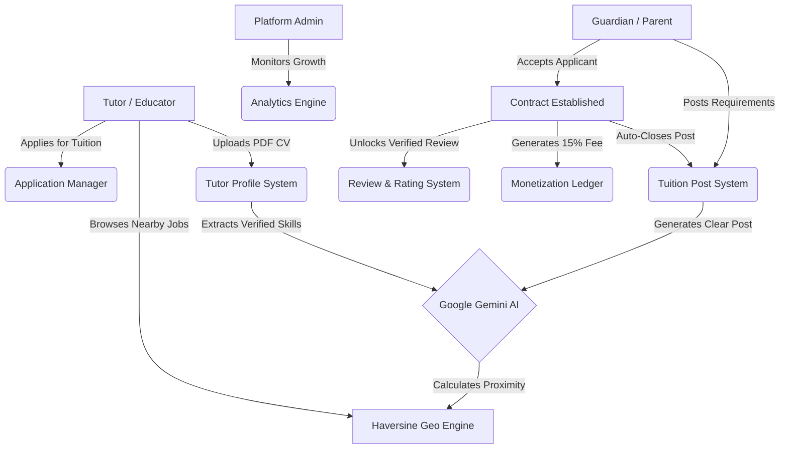
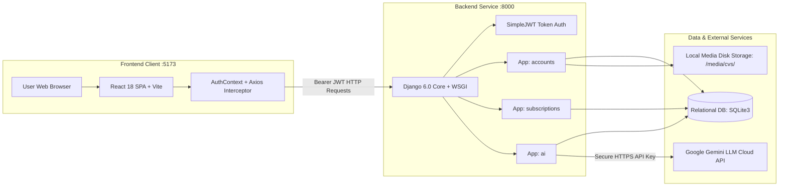
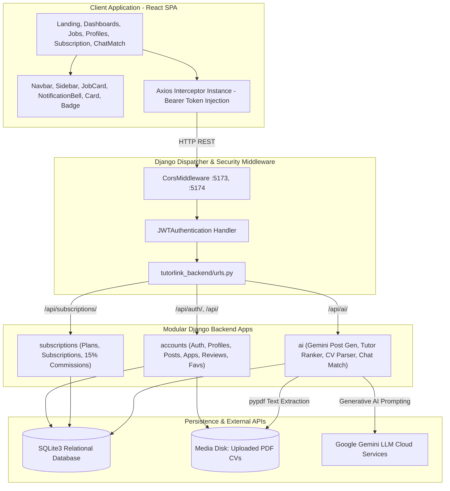
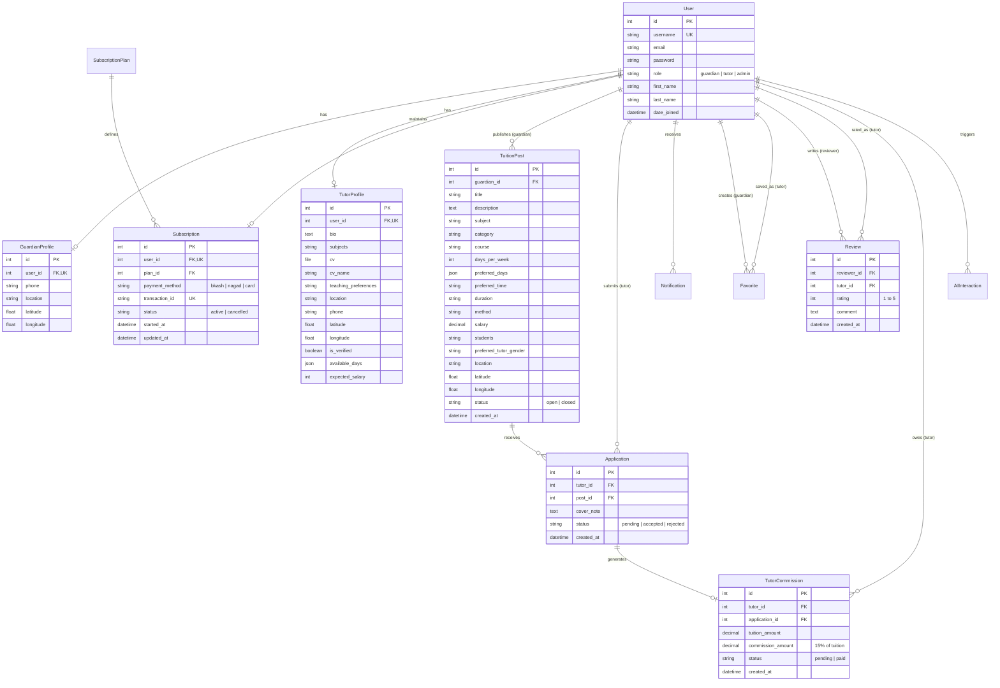
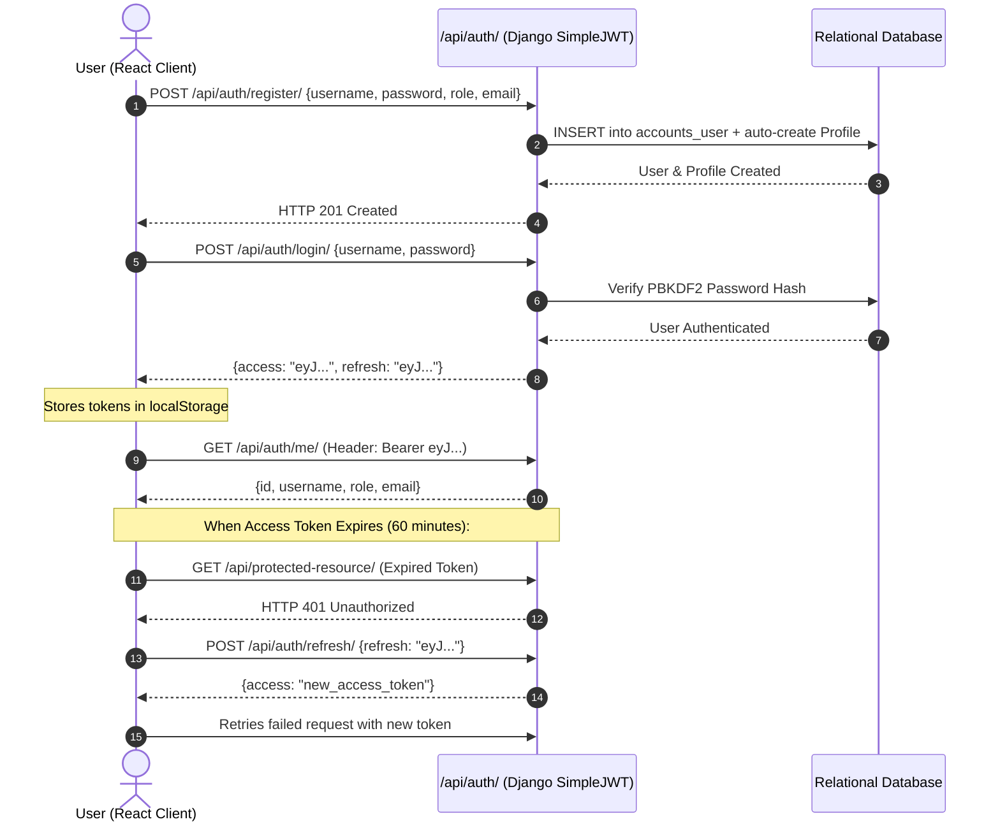
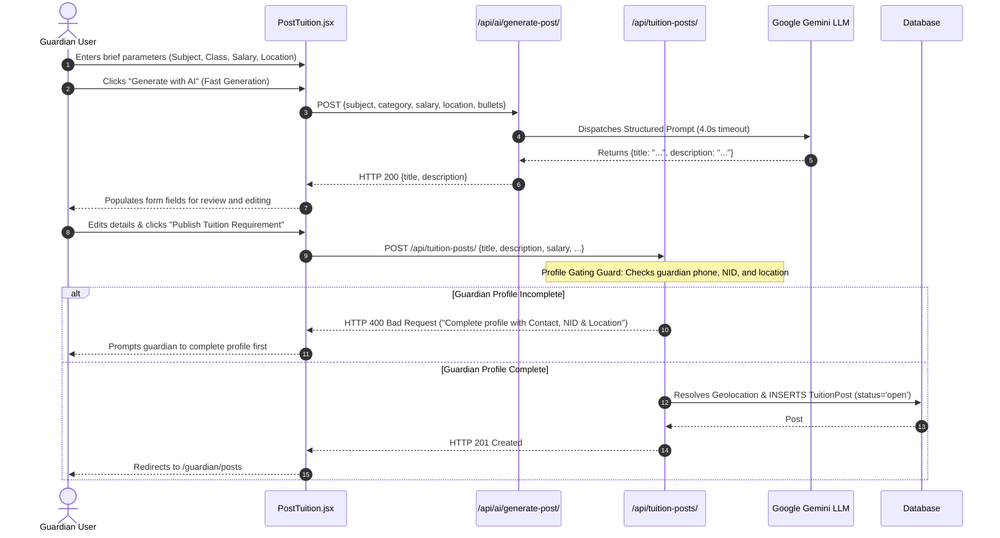
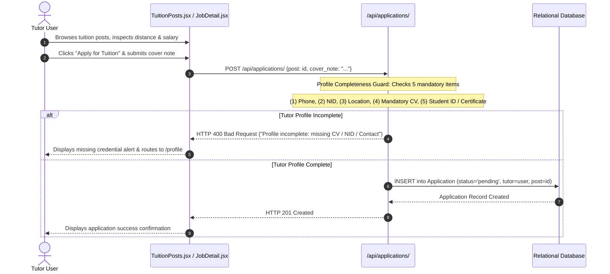
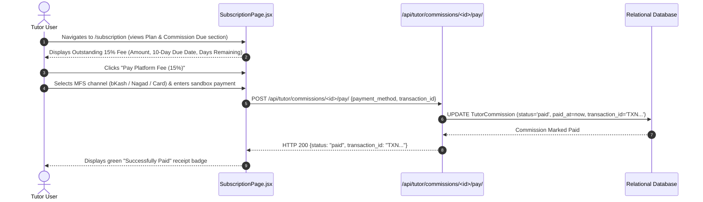

# Software Requirements Specification (SRS) & System Architecture Documentation

# TutorLink — Intelligent Tuition Matching & Management Platform

**Document Version:** 1.1.0  
**Standard Compliance:** IEEE Std 830-1998 (Recommended Practice for Software Requirements Specifications)  
**Publication Date:** September 24, 2026  
**Project Status:** Production-Ready / Final Year Defense  
**Repository Architecture:** Decoupled Full-Stack Monorepo (`/server` Django REST Framework + `/client` React Single Page Application)  

---

## Document Control & Revision History

| Version | Date | Primary Author | Description of Changes |
| :--- | :--- | :--- | :--- |
| **1.0.0** | 2026-09-10 | Engineering Team | Initial Comprehensive IEEE 830 SRS, Full Data Models, API Catalog, Mathematical Geo-Matching Derivations, Gemini AI Engine Architecture, and Monetization Specifications. |
| **1.1.0** | 2026-09-24 | Engineering Team | Updated specifications for: (1) Guardian profile status gating (phone, NID, location) for posting tuitions; (2) Tutor mandatory credentials & verification (phone, NID, location, mandatory CV upload, student ID or graduation certificate); (3) Demo class offer lifecycle (`demo_requested`) and direct guardian phone/directions disclosure; (4) Guardian applicant CV inspection; (5) 15% platform commission with 10-day payment grace period; (6) Removal of deprecated AI CV extractor; (7) Clean, production dashboard charts. |

---

# Table of Contents
1. [Section 1: Introduction & Project Overview](#section-1-introduction--project-overview)
   - 1.1 Purpose of the Document
   - 1.2 Document Conventions & Standards
   - 1.3 Intended Audience
   - 1.4 Project Scope & Objectives
   - 1.5 Problem Statement & Motivation (Bangladeshi Academic Context)
   - 1.6 Core Value Proposition & Solution Overview
   - 1.7 Definitions, Acronyms, and Abbreviations
2. [Section 2: Overall System Description](#section-2-overall-system-description)
   - 2.1 Product Perspective & Context Architecture
   - 2.2 User Classes and Actor Personas
   - 2.3 Operating Environment & Deployment Prerequisites
   - 2.4 Design and Implementation Constraints
   - 2.5 Assumptions and Dependencies
3. [Section 3: System Architecture & Technology Stack](#section-3-system-architecture--technology-stack)
   - 3.1 Technology Stack Matrix
   - 3.2 High-Level Architecture Diagram
   - 3.3 Backend Modular Architecture (`/server`)
   - 3.4 Frontend Architecture & Design System (`/client`)
   - 3.5 Network, Security & Communication Protocols
4. [Section 4: Complete Database Schema & Data Models](#section-4-complete-database-schema--data-models)
   - 4.1 Entity-Relationship (ER) Diagram
   - 4.2 Model Specification 1: Custom User (`accounts.User`)
   - 4.3 Model Specification 2: Guardian Profile (`accounts.GuardianProfile`)
   - 4.4 Model Specification 3: Tutor Profile (`accounts.TutorProfile`)
   - 4.5 Model Specification 4: Tuition Post (`accounts.TuitionPost`)
   - 4.6 Model Specification 5: Application (`accounts.Application`)
   - 4.7 Model Specification 6: Notification (`accounts.Notification`)
   - 4.8 Model Specification 7: Favorite / Bookmark (`accounts.Favorite`)
   - 4.9 Model Specification 8: Verified Review (`accounts.Review`)
   - 4.10 Model Specification 9: Subscription Plan (`subscriptions.SubscriptionPlan`)
   - 4.11 Model Specification 10: User Subscription (`subscriptions.Subscription`)
   - 4.12 Model Specification 11: Tutor Commission (`subscriptions.TutorCommission`)
   - 4.13 Model Specification 12: AI Audit Interaction (`ai.AIInteraction`)
5. [Section 5: Mathematical & Algorithmic Specifications](#section-5-mathematical--algorithmic-specifications)
   - 5.1 Geospatial Distance Calculation: The Haversine Formula
   - 5.2 Bangladeshi District Geolocation Fallback Matrix
   - 5.3 Priority Pro Subscription Boosting Algorithm
   - 5.4 Verified Review Eligibility & Anti-Fraud Algorithm
   - 5.5 Automatic Commission Ledger & 10-Day Grace Period Computation (15% Platform Fee)
6. [Section 6: Artificial Intelligence (Google Gemini) Engine Specifications](#section-6-artificial-intelligence-google-gemini-engine-specifications)
   - 6.1 Architectural Principles: Defensive Prompt Engineering
   - 6.2 Feature 1: AI Tuition Post Generator (`/api/ai/generate-post/`)
   - 6.3 Feature 2: AI Tutor Recommender (`/api/ai/recommend-tutors/<post_id>/`)
   - 6.4 Feature 3: Conversational AI Matching Assistant (`/api/ai/chat-match/`)
   - 6.5 AI Interaction Audit Logging & Token Tracking
7. [Section 7: Business Logic, Workflows & Sequence Diagrams](#section-7-business-logic-workflows--sequence-diagrams)
   - 7.1 User Registration, Authentication & JWT Lifecycle
   - 7.2 Tuition Posting & Profile Gating Workflow
   - 7.3 Job Discovery, Profile Completeness Verification & Application Submission
   - 7.4 Applicant Evaluation, CV Review, Demo Class Request & Hiring Workflow
   - 7.5 Verified Review & Rating Submission Workflow
   - 7.6 Subscription Checkout & 15% Platform Commission Payment Workflow
8. [Section 8: Functional Requirements (Detailed Requirements Matrix)](#section-8-functional-requirements-detailed-requirements-matrix)
   - 8.1 Module A: Authentication & User Management (`FR-AUTH`)
   - 8.2 Module B: Profile & Academic Credentials (`FR-PROF`)
   - 8.3 Module C: Tuition Job Postings (`FR-POST`)
   - 8.4 Module D: Applications & Matching (`FR-APP`)
   - 8.5 Module E: Verified Reviews & Ratings (`FR-REV`)
   - 8.6 Module F: Bookmarks & Saved Tutors (`FR-FAV`)
   - 8.7 Module G: Notifications System (`FR-NOTIF`)
   - 8.8 Module H: Platform Monetization & Subscriptions (`FR-SUB`)
   - 8.9 Module I: Artificial Intelligence Services (`FR-AI`)
   - 8.10 Module J: Administrative Oversight & Analytics (`FR-ADM`)
9. [Section 9: REST API Interface Specification (Complete Catalog)](#section-9-rest-api-interface-specification-complete-catalog)
10. [Section 10: Non-Functional Requirements (NFRs)](#section-10-non-functional-requirements-nfrs)
    - 10.1 Security & Protection Requirements
    - 10.2 Performance & Responsiveness Requirements
    - 10.3 Reliability & Availability Requirements
    - 10.4 Usability & Accessibility Standards
    - 10.5 Maintainability & Modular Portability
11. [Section 11: Deployment, Installation & Execution Guide](#section-11-deployment-installation--execution-guide)
    - 11.1 System Prerequisites
    - 11.2 Backend Deployment & Migration Steps
    - 11.3 Frontend Deployment & Build Steps
    - 11.4 Environment Configuration (`.env`)
12. [Section 12: Defense & Viva Guide (Examiner FAQ)](#section-12-defense--viva-guide-examiner-faq)

---

# Section 1: Introduction & Project Overview

## 1.1 Purpose of the Document
This Software Requirements Specification (SRS) document details the complete functional requirements, non-functional requirements, technical architecture, database schemas, API interfaces, mathematical algorithms, and machine-learning integrations for **TutorLink**. It is formatted in accordance with the IEEE Std 830-1998 standard to serve as the single source of truth for software engineers, viva examiners, system architects, and project stakeholders.

## 1.2 Document Conventions & Standards
- **IEEE Std 830-1998**: Guides the organizational structure, requirement classification, and traceability.
- **RFC 2119**: The terms **MUST**, **MUST NOT**, **REQUIRED**, **SHALL**, **SHALL NOT**, **SHOULD**, **SHOULD NOT**, **RECOMMENDED**, **MAY**, and **OPTIONAL** are interpreted as described in RFC 2119.
- **UML & C4 Model**: Architectural abstractions utilize standardized Unified Modeling Language (UML) notation and C4 context models for system visualization.

## 1.3 Intended Audience
- **Academic Reviewers & Viva Voce Examiners**: To evaluate architectural integrity, technical rigor, algorithm correctness, and engineering defense.
- **Full-Stack Software Engineers**: To understand backend models, serializers, API view contracts, and frontend state synchronization.
- **QA Engineers**: To verify end-to-end user journeys, role boundaries, security validations, and fallback resilience.
- **DevOps & System Administrators**: To manage runtime dependencies, environment variables, media uploads, and server ports.

## 1.4 Project Scope & Objectives
TutorLink is a full-stack web application designed to modernize the fragmented private tutoring ecosystem in Bangladesh. The platform bridges the gap between students/guardians and qualified academic tutors by combining:
1. **Role-Based Workspaces**: Tailored dashboards and interfaces for Guardians, Tutors, and System Administrators.
2. **Geospatial Proximity Matching**: Haversine distance computations matching tutors to job posts based on true geographic distance.
3. **Generative AI Capabilities**: Integration with Google Gemini for automated job drafting, context-aware tutor ranking, PDF CV skill extraction, and a natural-language matching chatbot.
4. **Verified Review System**: Strict cryptographic-style integrity requiring confirmed hiring before review authorization, preventing fake ratings.
5. **Sustainable Monetization Architecture**: Dual-revenue platform utilizing recurring monthly subscriptions (Guardian @ 30 BDT, Tutor @ 50 BDT) and a 15% platform commission on successful tuition hires.

## 1.5 Problem Statement & Motivation (Bangladeshi Academic Context)
In Bangladesh, private tuition is a multi-million-dollar informal market. However, it suffers from severe systemic friction:
- **Informal Media & Security Risks**: Tutors and guardians rely on unverified Facebook groups, notice boards, and intermediary brokers who charge exorbitant fees (often 50% to 100% of the first month's salary) with zero security guarantees.
- **Geographic Mismatch & Commute Fatigue**: Dhaka's severe traffic congestion means physical proximity is paramount. Guardians often hire tutors living across town, leading to irregular attendance and early dropouts.
- **Opaque Qualifications & Credential Fraud**: Fake certificates and exaggerated claims are widespread. Guardians lack an objective verification mechanism or verified peer reviews.
- **Unstructured Requirement Specification**: Guardians often struggle to articulate curriculum expectations (National Curriculum Bangla Version, English Version, Edexcel/Cambridge O/A Levels), leading to misaligned tutor applications.

TutorLink eliminates these issues through localized geographic computation, automated CV verification via LLM parsing, authenticated guardian-tutor contracts, and verified hire-only ratings.

## 1.6 Core Value Proposition & Solution Overview



## 1.7 Definitions, Acronyms, and Abbreviations
- **API**: Application Programming Interface
- **BDT**: Bangladeshi Taka (Local Currency, ISO 4217 code)
- **CORS**: Cross-Origin Resource Sharing
- **CV**: Curriculum Vitae / Resume
- **DRF**: Django REST Framework
- **ERD**: Entity-Relationship Diagram
- **Haversine**: Trigonometric formula for calculating great-circle distances on spherical surfaces
- **IEEE**: Institute of Electrical and Electronics Engineers
- **JWT**: JSON Web Token (RFC 7519)
- **LLM**: Large Language Model (specifically Google Gemini 3.6/3.7 Flash)
- **MFS**: Mobile Financial Services (e.g., bKash, Nagad)
- **NFR**: Non-Functional Requirement
- **ORM**: Object-Relational Mapping
- **REST**: Representational State Transfer
- **SPA**: Single-Page Application
- **SRS**: Software Requirements Specification
- **SSC / HSC**: Secondary School Certificate / Higher Secondary Certificate (National Curriculum of Bangladesh)
- **Vite**: Modern Next-Generation Frontend Tooling and Bundler

---

# Section 2: Overall System Description

## 2.1 Product Perspective & Context Architecture
TutorLink operates as an independent, decoupled web system consisting of a client application (Single Page Application in React) and a backend service (Django REST Framework) communicating over an asynchronous HTTP/REST protocol.



## 2.2 User Classes and Actor Personas
The system strictly enforces Role-Based Access Control (RBAC) across four primary user personas:

| Actor | Access Level | Responsibilities & Primary Objectives |
| :--- | :--- | :--- |
| **Guest / Visitor** | Unauthenticated Public | Browses landing page, platform statistics, public tutor directory, and public tuition jobs without viewing private contact details. Registers or logs in. |
| **Guardian / Parent** | Authenticated Role: `guardian` | Creates and manages tuition requirements, utilizes AI Post Generator, reviews tutor applicants with geographic proximity badges, accepts/rejects applications, bookmarks tutors, subscribes for Priority Pro access, and submits verified reviews post-hire. |
| **Tutor / Educator** | Authenticated Role: `tutor` | Creates teaching profile, sets available days and expected salary, uploads PDF CV, extracts academic subjects via Gemini AI, browses nearby jobs with distance sorting, applies to posts with cover notes, tracks application statuses, views commission dues, and subscribes for Priority Pro search ranking. |
| **System Administrator** | Authenticated Role: `admin` | Exercises global oversight, monitors user signups and platform metrics via visual analytics charts, verifies tutor profiles, and manages backend records via Django Admin. |

## 2.3 Operating Environment & Deployment Prerequisites
- **Client Runtime**: Modern web browsers supporting ES2020+ (Google Chrome 100+, Mozilla Firefox 100+, Apple Safari 15+, Microsoft Edge 100+).
- **Client Dev Server**: Node.js v18.0.0+ with npm v9.0.0+ running Vite dev server on `http://localhost:5173` (or fallback `5174`).
- **Server Runtime**: Python 3.10+, 3.11+, 3.12+, or 3.13+ running Django 6.0+ on `http://localhost:8000`.
- **Database Engine**: Relational SQLite 3 (development default) or PostgreSQL 15+ (production ready via `settings.py` adapter).
- **External Network Access**: Outbound HTTPS (Port 443) connectivity to Google Generative AI endpoints (`generativelanguage.googleapis.com`).

## 2.4 Design and Implementation Constraints
1. **Stateless Authentication**: Server sessions are disabled for API endpoints; all requests must carry standard `Authorization: Bearer <token>` headers validated via cryptographic signatures.
2. **Local Currency Formatting**: All financial figures must strictly represent Bangladeshi Taka (BDT) formatted with proper decimal handling.
3. **Zero-Leakage AI Keys**: Gemini API keys must reside strictly in server-side `.env` files; keys must never be packaged into frontend bundles or client network payloads.
4. **Defensive AI Fallbacks**: LLM requests must be wrapped in defensive try/catch blocks with deterministic heuristic fallbacks so that API quota limits or network interruptions never break end-user application workflows.
5. **Verified Review Integrity**: A guardian cannot review a tutor unless there is a confirmed relational record in `Application` with `status='accepted'`.

## 2.5 Assumptions and Dependencies
- Tutors upload valid PDF CV documents conforming to standard readable text encoding (processed using `pypdf`).
- Browsers grant optional HTML5 Geolocation API permission (`navigator.geolocation.getCurrentPosition`) for accurate GPS capture; when denied, the system seamlessly falls back to mapped district coordinates.

---

# Section 3: System Architecture & Technology Stack

## 3.1 Technology Stack Matrix

| Architectural Layer | Technology / Package | Version | Purpose in TutorLink |
| :--- | :--- | :--- | :--- |
| **Frontend Core** | React | 18.3.1 | Component-based dynamic user interface library |
| **Build & Bundling** | Vite | 5.4.11 | Fast HMR (Hot Module Replacement) and optimized production bundle compilation |
| **Routing** | React Router DOM | 7.18.2 | Declarative client-side routing, URL parameter extraction, and route guards |
| **HTTP Client** | Axios | 1.19.0 | Promise-based HTTP client with request/response interceptors for JWT injection and auto-refresh |
| **Visual Analytics** | Recharts | 3.10.1 | Composable SVG chart library rendering weekly signup analytics and dashboard metrics |
| **Styling & UI** | Vanilla CSS + CSS Modules | Native CSS3 | Pure design token system with glassmorphism, HSL color tokens, responsive grid layouts, and zero heavy dependencies |
| **Backend Core** | Python & Django | 3.12+ / 6.0.7 | High-level Python web framework providing ORM, migrations, admin panel, and security middlewares |
| **REST API Engine** | Django REST Framework | 3.15+ | Serializers, Class-Based API Views, generic views, pagination, and permissions |
| **Authentication** | djangorestframework-simplejwt | 5.3+ | RFC 7519 compliant JSON Web Token authentication with access/refresh token rotation |
| **CORS Middleware** | django-cors-headers | 4.3+ | Cross-Origin header negotiation allowing React on port 5173 to query Django on port 8000 |
| **Environment Config** | python-decouple | 3.8+ | Strict separation of parameters (`SECRET_KEY`, `GEMINI_API_KEY`, `DEBUG`) into `.env` |
| **AI / LLM Cloud API**| google-generativeai | 0.8+ | Official Google Gemini SDK (`gemini-3.6-flash` / `gemini-flash-latest`) |
| **Document Parsing** | pypdf | 4.0+ | Pure-Python PDF extraction library used to extract text from tutor CVs |
| **Database** | SQLite 3 / Relational | 3.x | Zero-configuration relational database with transactional integrity and foreign keys |

## 3.2 High-Level Architecture Diagram



## 3.3 Backend Modular Architecture (`/server`)
The Django backend enforces strict Separation of Concerns across three dedicated domain applications:
1. **`accounts`**: Manages entity identity, custom user models extending `AbstractUser`, profiles (`GuardianProfile`, `TutorProfile`), tuition requirements (`TuitionPost`), employment bids (`Application`), real-time database alerts (`Notification`), bookmarking (`Favorite`), and verified ratings (`Review`).
2. **`subscriptions`**: Manages the platform monetization lifecycle, pre-seeded subscription tiers (`SubscriptionPlan`), active subscriber billing records (`Subscription`), and post-hire platform fee accounting (`TutorCommission`).
3. **`ai`**: Encapsulates LLM prompt engineering, Gemini API orchestration, PDF CV text decoding via `pypdf`, zero-shot query intent extraction, and audit tracking (`AIInteraction`).

## 3.4 Frontend Architecture & Design System (`/client`)
The React client application employs a centralized state and token model:
- **Global Auth Context (`AuthContext.jsx`)**: Wraps the entire routing tree, maintaining user identity, token persistence in `localStorage`, and an Axios interceptor that automatically captures HTTP 401 Unauthorized errors and executes token refresh cycles via `/api/auth/refresh/`.
- **Protected Routing (`ProtectedRoute.jsx`)**: Enforces authentication state and verifies user role attributes against route constraints before rendering protected views.
- **Design Tokens (`index.css` & `design-system.md`)**: Fully custom, responsive CSS system utilizing modern design principles:
  - Theme colors: Primary Emerald (`#059669`), Accent Indigo (`#4f46e5`), Slate Dark backgrounds (`#0f172a`, `#1e293b`), and Surface Cards with subtle glassmorphic backdrop filters.
  - Consistent typography using Google Fonts (`Inter` and `Plus Jakarta Sans`).
  - Reusable micro-components: `Badge` (pill status), `Card` (glass elevation container), `EmptyState` (zero-data state), `LoadingSpinner`, and `NotificationBell` (real-time dropdown).

---

# Section 4: Complete Database Schema & Data Models

## 4.1 Entity-Relationship (ER) Diagram



---

## 4.2 Model Specification 1: Custom User (`accounts.User`)
Extends Django's `django.contrib.auth.models.AbstractUser`. Replaces standard auth user with role awareness.

| Field Name | Data Type | Constraints & Attributes | Description & Business Purpose |
| :--- | :--- | :--- | :--- |
| `id` | BigAutoField | Primary Key, Auto-increment | Unique identifier of the user record. |
| `username` | CharField(150) | Unique, Required | Alphanumeric unique handle used for credentials and public profile URLs. |
| `email` | EmailField(254) | Optional, Indexed | User's electronic mail address for contact and account recovery. |
| `password` | CharField(128) | Required, PBKDF2 Hashed | Cryptographically hashed password string (SHA-256 with salt iterations). |
| `role` | CharField(10) | Choices: `'guardian'`, `'tutor'`, `'admin'`. Default: `'guardian'` | Core platform persona governing permissions, dashboard redirection, and access boundaries. |
| `first_name` | CharField(150) | Blank allowed | Legal given name. |
| `last_name` | CharField(150) | Blank allowed | Legal surname. |
| `is_staff` | BooleanField | Default: `False` | Determines whether user can log into the Django Administration Console (`/admin/`). |
| `is_active` | BooleanField | Default: `True` | Soft-deletion and account ban status flag. |
| `date_joined` | DateTimeField | Default: `timezone.now` | User registration timestamp. Used by admin analytics to plot weekly signup growth. |

---

## 4.3 Model Specification 2: Guardian Profile (`accounts.GuardianProfile`)
Maintains extended personal, contact, national identification, and geolocation attributes for student guardians.

| Field Name | Data Type | Constraints & Attributes | Description & Business Purpose |
| :--- | :--- | :--- | :--- |
| `id` | BigAutoField | Primary Key, Auto-increment | Internal record ID. |
| `user` | OneToOneField | FK to `accounts.User`, `on_delete=CASCADE`, `related_name='guardian_profile'` | Unique one-to-one relationship ensuring a guardian has exactly one profile record. |
| `phone` | CharField(20) | Blank=True, Default: `''` | Mobile contact telephone number (e.g., `"+8801711000000"`). Required for profile completeness. |
| `nid_no` | CharField(50) | Blank=True, Default: `''`, Help: `"National ID Number"` | Guardian's National ID number. Required for verification and profile completeness. |
| `location` | CharField(255) | Blank=True, Default: `''` | Textual description of residence (e.g., `"House 12, Road 4, Sector 7, Uttara, Dhaka"`). Required for profile completeness. |
| `latitude` | FloatField | Null=True, Blank=True | Latitude coordinate obtained via browser GPS or district lookup table. |
| `longitude` | FloatField | Null=True, Blank=True | Longitude coordinate obtained via browser GPS or district lookup table. |

> **Model Property**: `@property is_profile_complete` evaluates `bool(phone and nid_no and location)`. A guardian **must** complete their profile before publishing tuition job posts.

---

## 4.4 Model Specification 3: Tutor Profile (`accounts.TutorProfile`)
Maintains academic credentials, verified skills, mandatory CV files, availability schedules, and target pricing for tutors.

| Field Name | Data Type | Constraints & Attributes | Description & Business Purpose |
| :--- | :--- | :--- | :--- |
| `id` | BigAutoField | Primary Key, Auto-increment | Internal record ID. |
| `user` | OneToOneField | FK to `accounts.User`, `on_delete=CASCADE`, `related_name='tutor_profile'` | Unique one-to-one relationship linking to tutor user account. |
| `bio` | TextField | Blank=True, Default: `''` | Personal statement, teaching philosophy, university background, and experience summary. |
| `subjects` | CharField(255) | Blank=True, Default: `''` | Comma-separated list of teaching competencies (e.g., `"Physics, Higher Math, ICT, Calculus"`). |
| `phone` | CharField(20) | Blank=True, Default: `''` | Tutor's contact telephone number. Required for profile completeness. |
| `nid_no` | CharField(50) | Blank=True, Default: `''`, Help: `"National ID Number"` | Tutor's National ID number. Required for verification and profile completeness. |
| `is_currently_student` | BooleanField | Default: `True` | Declares whether the tutor is currently enrolled as a student (`True`) or graduated/professional (`False`). |
| `student_id` | CharField(100) | Blank=True, Default: `''` | Student ID number if currently enrolled. Required for student tutors. |
| `certificate` | FileField | `upload_to='certificates/'`, Null=True, Blank=True | Uploaded graduation certificate or transcript. Required for non-student tutors. |
| `certificate_name` | CharField(255) | Blank=True, Default: `''` | Original client filename of the certificate document. |
| `cv` | FileField | `upload_to='cvs/'`, Null=True, Blank=True | **Mandatory** PDF CV document. Required for profile completeness and tuition application submissions. Reviewed directly by guardians. |
| `cv_name` | CharField(255) | Blank=True, Default: `''` | Original client filename of the uploaded CV document. |
| `teaching_preferences` | CharField(255) | Blank=True, Default: `''` | Preferred format: `'In-Person'`, `'Online'`, or `'Both'`. |
| `location` | CharField(255) | Blank=True, Default: `''` | Area or district of residence (e.g., `"Dhanmondi, Dhaka"`). Required for profile completeness. |
| `latitude` | FloatField | Null=True, Blank=True | GPS latitude coordinate for distance calculation. |
| `longitude` | FloatField | Null=True, Blank=True | GPS longitude coordinate for distance calculation. |
| `is_verified` | BooleanField | Default: `False` | Trust badge awarded by administrator confirming genuine academic background. |
| `available_days` | JSONField | Default: `list`, Blank=True | Array of weekday strings (e.g., `["Sunday", "Tuesday", "Thursday"]`). Used in AI Chat Match. |
| `expected_salary` | IntegerField | Null=True, Blank=True | Target monthly remuneration in BDT. Evaluated against guardian budget in AI Matching. |

> **Model Property**: `@property is_profile_complete` evaluates:
> `bool(phone and nid_no and location and cv and (student_id if is_currently_student else certificate))`.
> A tutor **must** complete their profile (5 mandatory credentials) before submitting tuition job applications.

---

## 4.5 Model Specification 4: Tuition Post (`accounts.TuitionPost`)
Represents an active or closed tuition requirement published by a Guardian.

| Field Name | Data Type | Constraints & Attributes | Description & Business Purpose |
| :--- | :--- | :--- | :--- |
| `id` | BigAutoField | Primary Key, Auto-increment | Unique job identifier. |
| `guardian` | ForeignKey | FK to `accounts.User`, `on_delete=CASCADE`, `related_name='tuition_posts'` | Identifies the guardian who published the post. |
| `title` | CharField(255) | Required | Headline description (e.g., `"Class 10 Physics & Higher Math Tutor Needed in Uttara"`). |
| `description` | TextField | Blank=True, Default: `''` | Comprehensive student needs and requirements (often generated by Gemini AI). |
| `subject` | CharField(100) | Required | Core academic subject(s) to be instructed. |
| `category` | CharField(100) | Blank=True, Default: `''` | Academic class level (e.g., `"Class 9-10 (SSC)"`, `"HSC (College)"`, `"Class 1-5 (Primary)"`). |
| `course` | CharField(100) | Blank=True, Default: `''` | Curriculum medium (e.g., `"National Curriculum (Bangla)"`, `"English Medium (Edexcel/Cambridge)"`). |
| `days_per_week` | IntegerField | Default: `3` | Number of weekly tutoring sessions required (1 to 7). |
| `preferred_days` | JSONField | Default: `list`, Blank=True | List of desired weekdays (e.g., `["Friday", "Saturday"]`). Evaluated in AI matching. |
| `preferred_time` | CharField(100) | Blank=True, Default: `''` | Preferred daily session time (e.g., `"5:00 PM"`). |
| `duration` | CharField(100) | Blank=True, Default: `''` | Length of each tutoring session (e.g., `"1.5 Hours"`). |
| `method` | CharField(100) | Default: `'In-Person'` | Delivery mode (`'In-Person'`, `'Online'`, `'Both'`). |
| `salary` | DecimalField(10,2) | Default: `8000.00` | Monthly compensation offered in BDT. Basis for 15% platform commission calculation. |
| `students` | CharField(50) | Blank=True, Default: `'1 Student'` | Number of pupils attending the sessions. |
| `preferred_tutor_gender` | CharField(20) | Blank=True, Default: `'Any'` | Tutor gender preference (`'Any'`, `'Male'`, `'Female'`). |
| `location` | CharField(255) | Default: `'Dhaka'` | Street or neighborhood location where tutoring occurs. |
| `latitude` | FloatField | Null=True, Blank=True | Post latitude coordinates used for applicant distance comparisons. |
| `longitude` | FloatField | Null=True, Blank=True | Post longitude coordinates used for applicant distance comparisons. |
| `status` | CharField(10) | Choices: `'open'`, `'closed'`. Default: `'open'` | Post state. Automatically transitions to `'closed'` upon hiring an applicant. |
| `created_at` | DateTimeField | `auto_now_add=True` | Post publication timestamp. Used for reverse-chronological sorting. |

---

## 4.6 Model Specification 5: Application (`accounts.Application`)
Tracks an educator's formal proposal to fulfill a tuition requirement.

| Field Name | Data Type | Constraints & Attributes | Description & Business Purpose |
| :--- | :--- | :--- | :--- |
| `id` | BigAutoField | Primary Key, Auto-increment | Application ID. |
| `tutor` | ForeignKey | FK to `accounts.User`, `on_delete=CASCADE`, `related_name='applications'` | The applying tutor account. |
| `post` | ForeignKey | FK to `accounts.TuitionPost`, `on_delete=CASCADE`, `related_name='applications'` | The target tuition posting. |
| `cover_note` | TextField | Blank=True, Default: `''` | Tutor's introductory message and qualification pitch to the guardian. |
| `status` | CharField(20) | Choices: `'pending'`, `'demo_requested'`, `'accepted'`, `'rejected'`. Default: `'pending'` | Application status. Supports trial demo class requests before hiring. When `'demo_requested'` or `'accepted'`, guardian contact number is revealed. |
| `created_at` | DateTimeField | `auto_now_add=True` | Application submission timestamp. |

---

## 4.7 Model Specification 6: Notification (`accounts.Notification`)
Provides in-app alerts and real-time updates accessible via the navbar notification bell icon.

| Field Name | Data Type | Constraints & Attributes | Description & Business Purpose |
| :--- | :--- | :--- | :--- |
| `id` | BigAutoField | Primary Key, Auto-increment | Notification ID. |
| `user` | ForeignKey | FK to `accounts.User`, `on_delete=CASCADE`, `related_name='notifications'` | Recipient of the alert. |
| `message` | TextField | Required | Clear alert content (e.g., `"Your application for 'Physics' was accepted!"`). |
| `is_read` | BooleanField | Default: `False` | Read status. Drives the unread count badge in `NotificationBell.jsx`. |
| `created_at` | DateTimeField | `auto_now_add=True` | Dispatch timestamp. |

---

## 4.8 Model Specification 7: Favorite / Bookmark (`accounts.Favorite`)
Maintains bookmarked tutor profiles saved by guardians for future contact.

| Field Name | Data Type | Constraints & Attributes | Description & Business Purpose |
| :--- | :--- | :--- | :--- |
| `id` | BigAutoField | Primary Key, Auto-increment | Record ID. |
| `guardian` | ForeignKey | FK to `accounts.User`, `on_delete=CASCADE`, `related_name='favorites'` | The guardian who saved the bookmark. |
| `tutor` | ForeignKey | FK to `accounts.User`, `on_delete=CASCADE`, `related_name='favorited_by'` | The saved tutor. |
| `created_at` | DateTimeField | `auto_now_add=True` | Timestamp. |
| *Constraint* | `unique_together` | `('guardian', 'tutor')` | Enforces that a guardian cannot bookmark the same tutor multiple times. |

---

## 4.9 Model Specification 8: Verified Review (`accounts.Review`)
Maintains authentic peer reviews and 1 to 5 star ratings submitted by guardians.

| Field Name | Data Type | Constraints & Attributes | Description & Business Purpose |
| :--- | :--- | :--- | :--- |
| `id` | BigAutoField | Primary Key, Auto-increment | Review ID. |
| `reviewer` | ForeignKey | FK to `accounts.User`, `on_delete=CASCADE`, `related_name='reviews_written'` | The authoring guardian. |
| `tutor` | ForeignKey | FK to `accounts.User`, `on_delete=CASCADE`, `related_name='reviews_received'` | The rated tutor. |
| `rating` | IntegerField | Default: `5`. Validated between `1` and `5` | Integer star rating score. |
| `comment` | TextField | Required | Written evaluation of tutor punctuality, mastery, and teaching effectiveness. |
| `created_at` | DateTimeField | `auto_now_add=True` | Review submission timestamp. |

---

## 4.10 Model Specification 9: Subscription Plan (`subscriptions.SubscriptionPlan`)
Defines the monetized access tiers configured on the platform.

| Field Name | Data Type | Constraints & Attributes | Description & Business Purpose |
| :--- | :--- | :--- | :--- |
| `id` | BigAutoField | Primary Key, Auto-increment | Plan tier ID. |
| `name` | CharField(100) | Required | Plan title (e.g., `"Guardian Monthly Pro"`, `"Tutor Monthly Pro"`). |
| `price` | DecimalField(10,2) | Required | Monthly recurring cost in BDT (`30.00` for Guardians, `50.00` for Tutors). |
| `role` | CharField(10) | Choices: `'guardian'`, `'tutor'`. Unique | Role restriction ensuring appropriate tier display. |
| `description` | TextField | Blank=True, Default: `''` | Summary of unlocked features (Priority Pro badge, AI Chat Match). |

---

## 4.11 Model Specification 10: User Subscription (`subscriptions.Subscription`)
Tracks the active paid subscriber state, payment method, and unique transaction audit ID for a user.

| Field Name | Data Type | Constraints & Attributes | Description & Business Purpose |
| :--- | :--- | :--- | :--- |
| `id` | BigAutoField | Primary Key, Auto-increment | Subscription record ID. |
| `user` | OneToOneField | FK to `accounts.User`, `on_delete=CASCADE`, `related_name='subscription'` | Ensures one active subscription record per user account. |
| `plan` | ForeignKey | FK to `subscriptions.SubscriptionPlan`, `on_delete=CASCADE` | Linked pricing tier. |
| `payment_method` | CharField(20) | Choices: `'bkash'`, `'nagad'`, `'card'`. Default: `'bkash'` | Payment channel selected during simulated checkout. |
| `transaction_id` | CharField(100) | Unique, Null=True, Blank=True | Transaction reference code (e.g., `"TXN202609101035008492"`). |
| `status` | CharField(20) | Choices: `'active'`, `'cancelled'`. Default: `'active'` | Subscription state. Drives feature unlocking in frontend and backend guards. |
| `started_at` | DateTimeField | `auto_now_add=True` | Subscription initiation timestamp. |
| `updated_at` | DateTimeField | `auto_now=True` | Last status change timestamp. |

---

## 4.12 Model Specification 11: Tutor Commission (`subscriptions.TutorCommission`)
Maintains the 15% platform hire fee ledger generated when a tutor is hired by a guardian, enforcing a 10-day payment grace period regardless of subscription tier.

| Field Name | Data Type | Constraints & Attributes | Description & Business Purpose |
| :--- | :--- | :--- | :--- |
| `id` | BigAutoField | Primary Key, Auto-increment | Commission ledger entry ID. |
| `tutor` | ForeignKey | FK to `accounts.User`, `on_delete=CASCADE`, `related_name='commissions'` | The tutor responsible for the platform fee. |
| `application` | ForeignKey | FK to `accounts.Application`, `on_delete=CASCADE`, `related_name='commission'` | The accepted application that generated this fee. |
| `tuition_amount` | DecimalField(10,2) | Required | Total monthly salary agreed upon in the tuition post. |
| `commission_amount` | DecimalField(10,2) | Required | Exact 15% platform fee calculated as: $\text{salary} \times 0.15$. |
| `status` | CharField(20) | Choices: `'pending'`, `'paid'`. Default: `'pending'` | Collection status of the commission fee (`pending` indicates due/unpaid). |
| `due_date` | DateTimeField | Null=True, Blank=True | Deadline for payment, automatically set to exactly 10 days from hire date ($T_{\text{hire}} + 10\text{ days}$). |
| `paid_at` | DateTimeField | Null=True, Blank=True | Timestamp when commission was successfully settled. |
| `payment_method` | CharField(20) | Blank=True, Default: `''` | MFS payment channel (`'bkash'`, `'nagad'`, `'card'`). |
| `transaction_id` | CharField(100) | Blank=True, Default: `''` | Unique payment transaction reference code. |
| `created_at` | DateTimeField | `auto_now_add=True` | Ledger generation timestamp. |

> **Model Properties**:
> - `@property days_left`: Returns number of calendar days remaining until `due_date` expires (0 if paid or past due).
> - `@property is_overdue`: Returns boolean `True` if unpaid and current timestamp has exceeded `due_date`.

---

## 4.13 Model Specification 12: AI Audit Interaction (`ai.AIInteraction`)
Provides immutable audit logging and token tracking for all calls to Google Gemini.

| Field Name | Data Type | Constraints & Attributes | Description & Business Purpose |
| :--- | :--- | :--- | :--- |
| `id` | BigAutoField | Primary Key, Auto-increment | Audit record ID. |
| `user` | ForeignKey | FK to `accounts.User`, `on_delete=CASCADE`, `related_name='ai_interactions'` | User who initiated the AI interaction. |
| `type` | CharField(50) | Choices: `'post_generator'`, `'tutor_recommendation'`, `'chatbot'` | AI feature category. |
| `input_text` | TextField | Required | Complete prompt string and parameters dispatched to Gemini. |
| `output_text` | TextField | Required | Raw or formatted JSON completion returned by Gemini. |
| `created_at` | DateTimeField | `auto_now_add=True` | Execution timestamp. |

---

# Section 5: Mathematical & Algorithmic Specifications

## 5.1 Geospatial Distance Calculation: The Haversine Formula
The system computes geographic distance across the Earth's curved surface to order and filter tutors relative to tuition posts.

### Why Not Standard Euclidean Distance?
Standard planar Euclidean distance ($\Delta d = \sqrt{(x_2-x_1)^2 + (y_2-y_1)^2}$) operates on a flat Cartesian plane. Because lines of longitude converge at the poles and the Earth has a mean radius of $R \approx 6371.0\text{ km}$, Euclidean calculations produce massive errors over geographic degree coordinates.

### The Haversine Trigonometric Formulation
Given two coordinates:
- Point 1 (Origin): $(\phi_1, \lambda_1) = (\text{lat}_1, \text{lon}_1)$
- Point 2 (Destination): $(\phi_2, \lambda_2) = (\text{lat}_2, \text{lon}_2)$

1. Convert coordinates from degrees to radians:
   $$\phi_1 = \text{lat}_1 \times \frac{\pi}{180}, \quad \phi_2 = \text{lat}_2 \times \frac{\pi}{180}$$
   $$\Delta \phi = (\text{lat}_2 - \text{lat}_1) \times \frac{\pi}{180}, \quad \Delta \lambda = (\text{lon}_2 - \text{lon}_1) \times \frac{\pi}{180}$$

2. Compute the square of half the chord length between the points ($a$):
   $$a = \sin^2\left(\frac{\Delta \phi}{2}\right) + \cos(\phi_1) \cdot \cos(\phi_2) \cdot \sin^2\left(\frac{\Delta \lambda}{2}\right)$$

3. Compute the angular distance in radians ($c$):
   $$c = 2 \cdot \text{atan2}\left(\sqrt{a}, \sqrt{1 - a}\right)$$

4. Compute the great-circle arc distance ($d$):
   $$d = R \cdot c = 6371.0 \times c \quad (\text{in kilometers})$$

```python
# accounts/utils.py Implementation
import math

def haversine_distance(lat1, lon1, lat2, lon2):
    if None in (lat1, lon1, lat2, lon2):
        return None
    try:
        lat1, lon1, lat2, lon2 = map(float, [lat1, lon1, lat2, lon2])
    except (TypeError, ValueError):
        return None

    EARTH_RADIUS_KM = 6371.0
    phi1 = math.radians(lat1)
    phi2 = math.radians(lat2)
    delta_phi = math.radians(lat2 - lat1)
    delta_lambda = math.radians(lon2 - lon1)

    a = (math.sin(delta_phi / 2.0) ** 2 +
         math.cos(phi1) * math.cos(phi2) *
         math.sin(delta_lambda / 2.0) ** 2)
    c = 2.0 * math.atan2(math.sqrt(a), math.sqrt(1.0 - a))
    return round(EARTH_RADIUS_KM * c, 1)
```

## 5.2 Bangladeshi District Geolocation Fallback Matrix
When users do not enable GPS or input manual coordinates, `get_district_coordinates()` executes a case-insensitive substring lookup against a pre-mapped dictionary of major Bangladeshi districts and Dhaka neighborhoods:

| Area / District Identifier | Latitude | Longitude | Primary Administrative Division |
| :--- | :---: | :---: | :--- |
| `dhaka` | 23.8103 | 90.4125 | Central Dhaka Metropolis |
| `uttara` | 23.8759 | 90.3795 | Dhaka North (Sectors 1-18) |
| `dhanmondi` | 23.7461 | 90.3742 | Dhaka Central (Roads 1-32) |
| `gulshan` | 23.7925 | 90.4167 | Dhaka Diplomatic Zone |
| `banani` | 23.7937 | 90.4043 | Dhaka Commercial Zone |
| `mirpur` | 23.8223 | 90.3654 | Dhaka Northwest |
| `mohammadpur` | 23.7658 | 90.3583 | Dhaka West |
| `motijheel` | 23.7330 | 90.4172 | Dhaka Financial District |
| `chittagong` / `chattogram` | 22.3569 | 91.7832 | Chattogram Division |
| `sylhet` | 24.8949 | 91.8687 | Sylhet Division |
| `gazipur` | 23.9999 | 90.4203 | Dhaka Outer Division |
| `narayanganj` | 23.6238 | 90.5000 | Dhaka Outer Division |
| `khulna` | 22.8456 | 89.5403 | Khulna Division |
| `rajshahi` | 24.3745 | 88.6042 | Rajshahi Division |
| `barishal` | 22.7010 | 90.3535 | Barishal Division |
| `rangpur` | 25.7439 | 89.2752 | Rangpur Division |
| `mymensingh` | 24.7471 | 90.4203 | Mymensingh Division |
| `cumilla` / `comilla` | 23.4607 | 91.1809 | Chattogram Division |

## 5.3 Priority Pro Subscription Boosting Algorithm
In `TutorListView` (`GET /api/tutors/`) and the AI Matchmaking engines:
1. All tutors possessing an active record in `Subscription` with `status='active'` receive the `is_subscribed = True` flag.
2. In the public directory, profiles are sorted with subscribed tutors positioned first:
   $$\text{sort\_key}(\text{tutor}) = 0 \text{ if } \text{tutor.id} \in \text{ActiveSubscribers} \text{ else } 1$$
3. In Gemini prompts, candidate JSON objects explicitly carry `"is_priority": true`. Gemini instructions require the LLM to prioritize these candidates when academic competencies are equal.

## 5.4 Verified Review Eligibility & Anti-Fraud Algorithm
To eliminate fraudulent reviews, the system enforces a strict relational check in `ReviewListCreateView` (`POST /api/reviews/`):
$$\text{CanReview}(G, T) = \exists A \in \text{Application} : (A.post.guardian = G) \land (A.tutor = T) \land (A.status = \text{'accepted'})$$
If no accepted application is found, the backend aborts review creation with HTTP 400 Bad Request: `"You can review this tutor after hiring them."`

## 5.5 Automatic Commission Ledger & 10-Day Grace Period Computation (15% Platform Fee)
When a guardian accepts an application (`PATCH /api/applications/<id>/` with `{"status": "accepted"}`):
1. `TuitionPost.status` is set to `'closed'`.
2. The commission fee is calculated using fixed decimal precision:
   $$\text{TuitionAmount} = \text{post.salary}$$
   $$\text{CommissionAmount} = \text{round}\left(\text{TuitionAmount} \times 0.15, 2\right)$$
3. The payment deadline is set to exactly 10 calendar days in the future:
   $$\text{DueDate} = \text{hire\_date} + 10 \text{ days}$$
4. A record is created in `TutorCommission` with `status='pending'` and `due_date=DueDate`.
5. The tutor must settle this 15% platform hire fee within 10 days, regardless of whether they hold an active Pro subscription tier. The status is tracked as due/pending until settled via in-app simulated MFS payment at `/subscription`.

---

# Section 6: Artificial Intelligence (Google Gemini) Engine Specifications

## 6.1 Architectural Principles: Defensive Prompt Engineering
TutorLink's AI integration in `/server/ai/views.py` follows strict production principles:
1. **Zero Client-Side Exposure**: Gemini API keys are accessed on the server via `decouple.config('GEMINI_API_KEY')`.
2. **Model Cascade Selection**: Tries `gemini-3.6-flash`, then `gemini-3.7-flash`, then `gemini-flash-latest`.
3. **Strict JSON Output Mandates**: Prompts instruct Gemini to return pure JSON without markdown backticks or commentary.
4. **Markdown Fence Sanitization**: Regex/string stripping removes any accidental ```json code blocks.
5. **Deterministic Heuristic Fallbacks**: In the event of API timeouts, token limits, or network exceptions, hardcoded heuristic algorithms generate sensible outputs, ensuring that user requests never fail with a 500 error.

## 6.2 Feature 1: AI Tuition Post Generator (`/api/ai/generate-post/`)
- **Endpoint**: `POST /api/ai/generate-post/`
- **Access**: Guardians and Admins (`IsAuthenticated`)
- **Input Parameters**: `subject`, `category`, `course`, `location`, `salary`, `days_per_week`, `bullets`
- **System Prompt**: Enforces an academic matchmaking copywriter persona calibrated for the Bangladeshi curriculum (SSC, HSC, English Medium). Formats output into a concise title and a 3-4 sentence description highlighting student needs and schedule.
- **Output Schema**:
  ```json
  {
    "title": "Class 10 Physics & Higher Math Tutor Needed in Uttara",
    "description": "Seeking an experienced and punctual tutor for a Class 10 SSC student in Uttara Sector 4. The student requires focused guidance in Physics and Higher Mathematics for upcoming board examinations. Classes will run 3 days per week with negotiable remuneration."
  }
  ```
- **Fallback Engine**: Assembles a formatted template combining input parameters if the LLM API is unavailable.

## 6.3 Feature 2: AI Tutor Recommender (`/api/ai/recommend-tutors/<post_id>/`)
- **Endpoint**: `POST /api/ai/recommend-tutors/<int:post_id>/`
- **Access**: Authoring Guardian or Admin (`IsAuthenticated`)
- **Workflow**:
  1. Fetches candidate tutors from `TutorProfile.objects.select_related('user')`.
  2. Queries active subscriptions and marks subscribed candidates with `"is_subscribed": true`.
  3. Sends candidate data and post requirements to Gemini.
  4. Returns ranked tutor IDs along with personalized 1-2 sentence match rationales.
- **Fallback Engine**: Sorts candidates heuristically: Subscribed tutors first, then matching subject keywords.

## 6.4 Feature 3: Conversational AI Matching Assistant (`/api/ai/chat-match/`)
- **Endpoint**: `POST /api/ai/chat-match/`
- **Access**: Active Paid Subscribers Only (`IsAuthenticated` + `Subscription.status == 'active'`)
- **Subscription Gate**: Users without an active subscription receive HTTP 403 Forbidden with `{ "error": "Active subscription required" }`.
- **Workflow**:
  1. **Intent Parsing**: Gemini extracts structured search filters from free-form natural language queries (e.g., `"Weekend Physics tutor in Uttara under 6000 BDT"` -> `subject: "Physics"`, `location: "Uttara"`, `max_budget: 6000`, `days: ["Friday", "Saturday"]`).
  2. **Database Querying**: Filters `TutorProfile` or `TuitionPost` records based on the parsed constraints.
  3. **Proximity Sorting**: Calculates Haversine distances for candidate matches.
  4. **AI Match Rationale**: Generates a personalized 1-sentence match explanation for each result.

## 6.5 AI Interaction Audit Logging & Token Tracking
Every call to an AI endpoint logs an entry in `AIInteraction` containing:
- `user_id`: Requesting user
- `type`: Feature identifier (`'post_generator'`, `'tutor_recommendation'`, `'chatbot'`)
- `input_text`: Prompt payload
- `output_text`: Raw/parsed response
- `created_at`: Timestamp

---

# Section 7: Business Logic, Workflows & Sequence Diagrams

## 7.1 User Registration, Authentication & JWT Lifecycle



---

## 7.2 Tuition Posting & Profile Gating Workflow



---

## 7.3 Job Discovery, Profile Completeness Verification & Application Submission



---

## 7.4 Applicant Evaluation, CV Review, Demo Class Request & Hiring Workflow

```mermaid
sequenceDiagram
    autonumber
    actor Guardian as Guardian User
    participant UI as GuardianApplicants.jsx
    participant AppAPI as /api/applications/<id>/
    participant DB as Relational Database
    actor Tutor as Tutor User

    Guardian->>UI: Navigates to /guardian/applicants
    UI->>AppAPI: GET /api/applications/
    AppAPI->>DB: Queries Applications + Computes Haversine Distance + Retrieves tutor CV URL
    DB-->>AppAPI: Returns applications with distance_km, tutor_cv, tutor_cv_name
    AppAPI-->>UI: Applications list
    UI-->>Guardian: Displays applicant cards with distance badges and "📄 View Tutor CV" button

    Guardian->>UI: Clicks "📄 View Tutor CV"
    UI-->>Guardian: Opens Tutor's uploaded PDF CV document in new browser tab

    alt Guardian Requests Trial Demo Class
        Guardian->>UI: Clicks "🎓 Ask for Demo"
        UI->>AppAPI: PATCH /api/applications/<id>/ {status: "demo_requested"}
        AppAPI->>DB: 1. Update Application status = 'demo_requested'
        AppAPI->>DB: 2. INSERT Notification ("Selected for demo class by guardian")
        DB-->>AppAPI: Updated
        AppAPI-->>UI: HTTP 200 {status: "demo_requested"}
        UI-->>Guardian: Displays Demo Requested status badge
        Note over Tutor: Tutor sees demo count increase, receives alert, and guardian phone is revealed
    else Guardian Directly Accepts & Hires
        Guardian->>UI: Clicks "✓ Accept" (Directly or after Demo)
        UI->>AppAPI: PATCH /api/applications/<id>/ {status: "accepted"}
        AppAPI->>DB: 1. Update Application status = 'accepted'
        AppAPI->>DB: 2. Update TuitionPost status = 'closed'
        AppAPI->>DB: 3. INSERT TutorCommission (15% salary, status='pending', due_date=now+10days)
        AppAPI->>DB: 4. INSERT Notification for Tutor ("You are hired!")
        DB-->>AppAPI: Transaction Committed
        AppAPI-->>UI: HTTP 200 {status: "accepted"}
        UI-->>Guardian: Updates UI state to "Accepted / Hired"
        Note over Tutor: Tutor dashboard reveals guardian phone & directions; 15% fee logged with 10-day deadline
    end
```

---

## 7.5 Subscription Checkout & 15% Platform Commission Payment Workflow



---

# Section 8: Functional Requirements (Detailed Requirements Matrix)

## 8.1 Module A: Authentication & User Management (`FR-AUTH`)

| ID | Title | Description | Inputs | Expected Output | Permission |
| :--- | :--- | :--- | :--- | :--- | :--- |
| **FR-AUTH-01** | User Registration | Allows any guest visitor to create an account by specifying a username, password, email, and role. | `username`, `password`, `email`, `role` (`guardian` or `tutor`) | User account created, initial profile generated, HTTP 201 Created. | `AllowAny` |
| **FR-AUTH-02** | JWT Login | Authenticates user credentials and issues signed access and refresh tokens. | `username`, `password` | JWT pair: `{access, refresh}`, HTTP 200 OK. | `AllowAny` |
| **FR-AUTH-03** | Token Refresh | Generates a new access token using a valid, non-expired refresh token. | `refresh` token string | `{access: "..."}`, HTTP 200 OK. | `AllowAny` |
| **FR-AUTH-04** | Current User Profile | Returns the authenticated user's session profile, username, email, and role. | Bearer access token | User representation JSON, HTTP 200 OK. | `IsAuthenticated` |

## 8.2 Module B: Profile & Academic Credentials (`FR-PROF`)

| ID | Title | Description | Inputs | Expected Output | Permission |
| :--- | :--- | :--- | :--- | :--- | :--- |
| **FR-PROF-01** | Guardian Profile Management | Retrieves and updates contact phone, NID number, address, and GPS coordinates for guardians. Enforces profile completion. | `phone`, `nid_no`, `location`, `latitude`, `longitude` | Updated `GuardianProfile` JSON. | `IsAuthenticated` (Guardian) |
| **FR-PROF-02** | Tutor Profile Management | Retrieves and updates bio, subjects, phone, NID, student ID/certificate, teaching preferences, availability, and salary. | `phone`, `nid_no`, `student_id`, `certificate`, `bio`, `subjects`, `preferences`, `available_days`, `expected_salary` | Updated `TutorProfile` JSON. | `IsAuthenticated` (Tutor) |
| **FR-PROF-03** | Tutor Mandatory PDF CV Upload | Accepts a PDF CV document, saves it to `/media/cvs/`, and marks the profile CV requirement complete. | Multipart form-data with `cv` file | Profile JSON containing updated `cv_name` and file URL. | `IsAuthenticated` (Tutor) |
| **FR-PROF-04** | Public Tutor Directory | Lists all registered tutors, displaying subjects, locations, star ratings, and Priority Pro badges. | Query params: optional subject/location | Array of tutor card objects, sorted with subscribed tutors first. | `AllowAny` |
| **FR-PROF-05** | Public Tutor Profile Detail | Returns comprehensive public profile details, ratings, and past reviews for a tutor. | URL path: `tutor_id` | Tutor profile object with `reviews` array and `can_review` flag. | `AllowAny` |

## 8.3 Module C: Tuition Job Postings (`FR-POST`)

| ID | Title | Description | Inputs | Expected Output | Permission |
| :--- | :--- | :--- | :--- | :--- | :--- |
| **FR-POST-01** | List Tuition Posts | Returns open tuition postings ordered by creation date, supporting location search and `?mine=true`. | Query params: `location`, `mine` | Array of tuition post objects with calculated `distance_km`. | `AllowAny` |
| **FR-POST-02** | Create Tuition Post (Gated) | Allows guardians to publish new tuition requirements. **Strictly validates** guardian profile completeness (`phone`, `nid_no`, `location`). Automatically resolves coordinates. | Subject, class, salary, schedule, location | Created `TuitionPost` object with `status='open'`. Returns HTTP 400 if profile incomplete. | `IsAuthenticated` (Guardian) |
| **FR-POST-03** | Retrieve Post Detail | Returns complete requirements, student count, budget, and location coordinates for a post. | URL path: `post_id` | Detailed tuition post object. | `AllowAny` |
| **FR-POST-04** | Update Tuition Post | Allows the authoring guardian to edit requirements, schedule, or compensation for their post. | Updated post fields | Updated `TuitionPost` object. | `IsOwnerOrReadOnly` |
| **FR-POST-05** | Delete Tuition Post | Allows the authoring guardian to remove their tuition post. | URL path: `post_id` | HTTP 204 No Content. | `IsOwnerOrReadOnly` |

## 8.4 Module D: Applications & Matching (`FR-APP`)

| ID | Title | Description | Inputs | Expected Output | Permission |
| :--- | :--- | :--- | :--- | :--- | :--- |
| **FR-APP-01** | Submit Application (Gated) | Allows a tutor to apply for an open tuition post. **Strictly validates** tutor profile completeness (phone, NID, location, mandatory CV, student ID / certificate). | `post` ID, `cover_note` | Created `Application` record with `status='pending'`. Returns HTTP 400 with missing fields if incomplete. | `IsAuthenticated` (Tutor) |
| **FR-APP-02** | List Applications | Returns applications filtered by role (tutors see submitted applications; guardians see received applications with `tutor_cv` and `distance_km`). | Bearer token | Array of applications with post details, Haversine distances, and tutor CV download links. | `IsAuthenticated` |
| **FR-APP-03** | Application Status Update | Allows the authoring guardian to update status (`'demo_requested'`, `'accepted'`, `'rejected'`). Accepting closes the post, records 15% commission (10-day deadline), and dispatches notifications. On demo or accept, reveals guardian phone number to tutor. | `status` (`'demo_requested'`, `'accepted'`, or `'rejected'`) | Updated application object; triggered side-effects executed. | `IsAuthenticated` (Guardian Owner) |
| **FR-APP-04** | Guardian CV Inspection | Enables guardians to view and evaluate the tutor's uploaded PDF CV document directly on applicant cards before deciding to request a demo or hire. | URL link: `tutor_cv` | Opens uploaded PDF CV file in new tab. | `IsAuthenticated` (Guardian) |

## 8.5 Module E: Verified Reviews & Ratings (`FR-REV`)

| ID | Title | Description | Inputs | Expected Output | Permission |
| :--- | :--- | :--- | :--- | :--- | :--- |
| **FR-REV-01** | Submit Verified Review | Allows a guardian to submit a 1 to 5 star rating and comment for a tutor they have hired. | `tutor` ID, `rating` (1-5), `comment` | Created `Review` record, HTTP 201 Created. | `IsAuthenticated` (Verified Guardian) |
| **FR-REV-02** | List Tutor Reviews | Public endpoint returning all reviews, feedback comments, and aggregate star rating for a tutor. | URL path: `tutor_id` | Object with `reviews` array, `average_rating`, and `review_count`. | `AllowAny` |

## 8.6 Module F: Bookmarks & Saved Tutors (`FR-FAV`)

| ID | Title | Description | Inputs | Expected Output | Permission |
| :--- | :--- | :--- | :--- | :--- | :--- |
| **FR-FAV-01** | Toggle Bookmark (Add) | Allows a guardian to bookmark a qualified tutor for future reference. | URL path: `tutor_id` | `{status: "favorited", is_favorited: true}`, HTTP 201. | `IsAuthenticated` (Guardian) |
| **FR-FAV-02** | Toggle Bookmark (Remove)| Removes a tutor from the guardian's saved favorites collection. | URL path: `tutor_id` (DELETE) | `{status: "unfavorited", is_favorited: false}`, HTTP 200. | `IsAuthenticated` (Guardian) |
| **FR-FAV-03** | List Saved Tutors | Returns the list of all tutors bookmarked by the logged-in guardian. | Bearer token | Array of saved tutor profile cards. | `IsAuthenticated` (Guardian) |

## 8.7 Module G: Notifications System (`FR-NOTIF`)

| ID | Title | Description | Inputs | Expected Output | Permission |
| :--- | :--- | :--- | :--- | :--- | :--- |
| **FR-NOTIF-01**| List User Alerts | Returns system alerts (demo class requests, hire confirmations, application responses) ordered newest first. | Bearer token | Array of notification objects with read/unread status. | `IsAuthenticated` |
| **FR-NOTIF-02**| Mark Alert as Read | Marks an individual notification as read when viewed by the user. | URL path: `notification_id` | Updated notification object with `is_read=True`. | `IsAuthenticated` (Recipient) |

## 8.8 Module H: Platform Monetization & Subscriptions (`FR-SUB`)

| ID | Title | Description | Inputs | Expected Output | Permission |
| :--- | :--- | :--- | :--- | :--- | :--- |
| **FR-SUB-01** | List Pricing Plans | Returns available subscription tiers for the user's role (Guardian: 30 BDT, Tutor: 50 BDT). | Bearer token | Array of subscription plan tiers. | `IsAuthenticated` |
| **FR-SUB-02** | My Subscription Status | Returns current user subscription status, plan details, and expiration. | Bearer token | `{is_subscribed: bool, status: "...", plan: {...}}`. | `IsAuthenticated` |
| **FR-SUB-03** | Process Subscription | Activates or renews a subscription via simulated checkout, issuing a unique transaction ID. | `payment_method` (`bkash`, `nagad`, `card`) | Subscription record with unique TXN code and receipt metadata. | `IsAuthenticated` |
| **FR-SUB-04** | Cancel Subscription | Cancels an active subscription, updating status to `'cancelled'`. | Bearer token | Updated subscription record with `status='cancelled'`. | `IsAuthenticated` |
| **FR-SUB-05** | Tutor Commission Ledger | Returns the 15% platform hire fee obligations for the logged-in tutor, showing due dates (10-day limit), days remaining, and payment status. | Bearer token | Array of commission records with tuition salary, 15% fee amounts, `due_date`, and `days_left`. | `IsAuthenticated` (Tutor) |
| **FR-SUB-06** | Pay Tutor Commission | Allows tutors to settle their 15% hire commission fee within the 10-day grace period via simulated MFS payment. | `payment_method` (`bkash`, `nagad`, `card`) | Updated commission record marked `status='paid'` with transaction ID. | `IsAuthenticated` (Tutor) |

## 8.9 Module I: Artificial Intelligence Services (`FR-AI`)

| ID | Title | Description | Inputs | Expected Output | Permission |
| :--- | :--- | :--- | :--- | :--- | :--- |
| **FR-AI-01** | AI Post Generator | Uses Google Gemini with optimized latency (4.0s timeout + instant template fallback) to generate engaging post titles and structured descriptions. | `subject`, `category`, `salary`, `location`, `bullets` | `{title: "...", description: "..."}`. | `IsAuthenticated` (Guardian/Admin) |
| **FR-AI-02** | AI Tutor Recommender | Evaluates registered tutors against post requirements, ranks candidates, and generates match explanations. | URL path: `post_id` | Ranked candidate list with personalized match reasons. | `IsAuthenticated` (Guardian Owner) |
| **FR-AI-03** | AI Chat Match Assistant | Natural language tuition and tutor matching assistant gated to active subscribers. | Natural language search query | Extracted filters, ranked candidates, and AI match reasons. | `IsAuthenticated` + Active Subscription |

## 8.10 Module J: Administrative Oversight & Analytics (`FR-ADM`)

| ID | Title | Description | Inputs | Expected Output | Permission |
| :--- | :--- | :--- | :--- | :--- | :--- |
| **FR-ADM-01** | Platform Analytics | Returns system counts (users, posts, applications) and weekly signup trends for the last 8 weeks. | Bearer token | System metrics object with `signups_per_week` array. | `IsAuthenticated` + Role: `admin` |

---

# Section 9: REST API Interface Specification (Complete Catalog)

The backend provides 35 specialized endpoints across the `accounts`, `subscriptions`, and `ai` applications:

| # | HTTP Method | Endpoint URL | Django View Class | Auth / Permission | Request Payload / Query Params | Success Response (HTTP Status) |
| :---: | :--- | :--- | :--- | :--- | :--- | :---: |
| 1 | `POST` | `/api/auth/register/` | `RegisterView` | `AllowAny` | `{username, email, password, role, first_name, last_name}` | `201 Created` |
| 2 | `POST` | `/api/auth/login/` | `TokenObtainPairView` | `AllowAny` | `{username, password}` | `200 OK` (`access`, `refresh`) |
| 3 | `POST` | `/api/auth/refresh/` | `TokenRefreshView` | `AllowAny` | `{refresh}` | `200 OK` (`access`) |
| 4 | `GET` | `/api/auth/me/` | `MeView` | `IsAuthenticated` | None | `200 OK` (User details) |
| 5 | `GET` | `/api/guardian/profile/` | `GuardianProfileView` | `IsAuthenticated` | None | `200 OK` (Guardian Profile) |
| 6 | `PUT/PATCH` | `/api/guardian/profile/` | `GuardianProfileView` | `IsAuthenticated` | `{phone, nid_no, location, latitude, longitude}` | `200 OK` |
| 7 | `GET` | `/api/tutor/profile/` | `TutorProfileView` | `IsAuthenticated` | None | `200 OK` (Tutor Profile) |
| 8 | `PUT/PATCH` | `/api/tutor/profile/` | `TutorProfileView` | `IsAuthenticated` | `{phone, nid_no, student_id, bio, subjects, preferences, available_days, expected_salary}` | `200 OK` |
| 9 | `POST` | `/api/tutor/upload-cv/` | `TutorCVUploadView` | `IsAuthenticated` | Multipart Form Data: `cv` (Mandatory PDF File) | `200 OK` |
| 10 | `GET` | `/api/tuition-posts/` | `TuitionPostListCreateView` | `AllowAny` | Optional: `?location=`, `?mine=true` | `200 OK` (Array of Posts) |
| 11 | `POST` | `/api/tuition-posts/` | `TuitionPostListCreateView` | `IsAuthenticated` (Guardian with complete profile) | `{title, description, subject, category, salary, location, ...}` | `201 Created` |
| 12 | `GET` | `/api/tuition-posts/<id>/`| `TuitionPostDetailView` | `AllowAny` | None | `200 OK` |
| 13 | `PUT/PATCH` | `/api/tuition-posts/<id>/`| `TuitionPostDetailView` | `IsOwnerOrReadOnly` | `{title, description, salary, ...}` | `200 OK` |
| 14 | `DELETE` | `/api/tuition-posts/<id>/`| `TuitionPostDetailView` | `IsOwnerOrReadOnly` | None | `204 No Content` |
| 15 | `GET` | `/api/applications/` | `ApplicationListCreateView` | `IsAuthenticated` | None (Includes `tutor_cv`, `distance_km`, `guardian_phone`) | `200 OK` (Array of Apps) |
| 16 | `POST` | `/api/applications/` | `ApplicationListCreateView` | `IsAuthenticated` (Tutor with complete profile + CV) | `{post: <post_id>, cover_note: "..."}` | `201 Created` |
| 17 | `PATCH` | `/api/applications/<id>/`| `ApplicationDetailView` | `IsAuthenticated` (Guardian Owner) | `{"status": "demo_requested" \| "accepted" \| "rejected"}` | `200 OK` |
| 18 | `GET` | `/api/notifications/` | `NotificationListView` | `IsAuthenticated` | None | `200 OK` (Array of Alerts) |
| 19 | `PUT` | `/api/notifications/<id>/read/` | `NotificationMarkReadView` | `IsAuthenticated` | None | `200 OK` |
| 20 | `GET` | `/api/favorites/` | `FavoriteListView` | `IsAuthenticated` (Guardian) | None | `200 OK` (Saved Tutors) |
| 21 | `POST/DEL`| `/api/favorites/<tutor_id>/` | `FavoriteToggleView` | `IsAuthenticated` (Guardian) | None | `200 OK` / `201 Created` |
| 22 | `POST` | `/api/reviews/` | `ReviewListCreateView` | `IsAuthenticated` (Guardian) | `{tutor: <id>, rating: 1-5, comment: "..."}` | `201 Created` |
| 23 | `GET` | `/api/tutors/` | `TutorListView` | `AllowAny` | Optional search query | `200 OK` (Tutors Array) |
| 24 | `GET` | `/api/tutors/<id>/` | `TutorDetailView` | `AllowAny` | None | `200 OK` (Tutor + `can_review`) |
| 25 | `GET` | `/api/tutors/<id>/reviews/` | `TutorReviewListView` | `AllowAny` | None | `200 OK` (Reviews + Average) |
| 26 | `GET` | `/api/admin/analytics/` | `AdminAnalyticsView` | `IsAuthenticated` (Admin) | None | `200 OK` (System Metrics) |
| 27 | `GET` | `/api/subscriptions/plans/` | `SubscriptionPlanListView` | `IsAuthenticated` | None (Returns plans for role) | `200 OK` |
| 28 | `GET` | `/api/subscriptions/mine/` | `MySubscriptionView` | `IsAuthenticated` | None | `200 OK` (`is_subscribed`) |
| 29 | `POST` | `/api/subscriptions/subscribe/` | `SubscribeView` | `IsAuthenticated` | `{payment_method: "bkash" \| "nagad" \| "card"}` | `200 OK` (Receipt + TXN ID) |
| 30 | `POST` | `/api/subscriptions/cancel/` | `CancelSubscriptionView` | `IsAuthenticated` | None | `200 OK` |
| 31 | `GET` | `/api/tutor/commissions/` | `TutorCommissionListView` | `IsAuthenticated` (Tutor) | None | `200 OK` (15% Fee Ledger + Due Date) |
| 32 | `POST` | `/api/tutor/commissions/<id>/pay/` | `TutorCommissionPayView` | `IsAuthenticated` (Tutor) | `{payment_method: "bkash" \| "nagad" \| "card"}` | `200 OK` (Commission Settled) |
| 33 | `POST` | `/api/ai/generate-post/` | `GeneratePostView` | `IsAuthenticated` (Guardian/Admin) | `{subject, category, salary, location, bullets}` | `200 OK` (`title`, `desc`) |
| 34 | `POST` | `/api/ai/recommend-tutors/<id>/` | `RecommendTutorsView` | `IsAuthenticated` (Guardian Owner) | None | `200 OK` (Ranked Tutors) |
| 35 | `POST` | `/api/ai/chat-match/` | `ChatMatchView` | `IsAuthenticated` + Active Sub | `{query: "natural language query"}` | `200 OK` (Matches + Reasons) |

---

# Section 10: Non-Functional Requirements (NFRs)

## 10.1 Security & Protection Requirements
1. **Password Hashing**: Passwords must be hashed using Django's PBKDF2 algorithm with a SHA-256 hash and salt iterations. Raw passwords must never be stored or logged.
2. **Stateless JWT Security**: Access tokens carry a lifetime of 60 minutes; refresh tokens expire after 24 hours. Tokens must be signed with the server's `SECRET_KEY`.
3. **CORS Isolation**: The backend must only accept Cross-Origin requests from authorized frontend origins (`http://localhost:5173` and `http://localhost:5174`).
4. **Object-Level Authorization**: `IsOwnerOrReadOnly` ensures that users can only modify or delete records that they created.
5. **AI Credential Protection**: The `GEMINI_API_KEY` must never be exposed to the client application or version control.
6. **SQL Injection Prevention**: All database queries must use Django ORM parameterized statements.

## 10.2 Performance & Responsiveness Requirements
1. **API Latency**: Relational queries (`GET /api/tuition-posts/`, `GET /api/tutors/`) must respond within 150ms under typical local conditions.
2. **AI Generation Timeout**: External calls to Google Gemini must complete within 4.0 seconds; if exceeded, the heuristic fallback engine activates.
3. **Frontend Bundle Optimization**: The production bundle compiled by Vite must not exceed 500 KB (gzipped), ensuring fast initial page loads.
4. **Token Refresh Interception**: Expired access tokens must be refreshed transparently via Axios interceptors without disrupting active user operations.

## 10.3 Reliability & Fault Tolerance
1. **Database Integrity**: Relational foreign keys must maintain referential integrity via `CASCADE` or `SET_NULL` delete constraints.
2. **LLM Error Insulation**: All Gemini calls must be wrapped in try/except blocks, falling back to local heuristic engines during network or quota failures.
3. **Graceful Geolocation Degradation**: If browser GPS is denied or unavailable, the system must seamlessly fall back to district lookup coordinates.

## 10.4 Usability & Accessibility Standards
1. **Responsive Design**: Interfaces must adapt seamlessly to desktop screens (1920x1080), laptops (1366x768), tablets (768x1024), and mobile screens (375x667).
2. **Color Contrast**: Text and interactive elements must satisfy WCAG 2.1 AA contrast ratios (minimum 4.5:1 for normal text).
3. **Design Tokens**: UI styling must use consistent tokens defined in `index.css`, avoiding ad-hoc inline styles.

## 10.5 Maintainability & Modular Portability
1. **Modular Codebase**: Business domains must be segregated into distinct Django apps (`accounts`, `subscriptions`, `ai`).
2. **Database Portability**: The ORM layer must remain database-agnostic, allowing seamless migration from SQLite to PostgreSQL by altering `settings.py`.

---

# Section 11: Deployment, Installation & Execution Guide

## 11.1 System Prerequisites
- **Python**: Version 3.10, 3.11, 3.12, or 3.13
- **Node.js**: Version 18.0.0 or higher
- **Package Managers**: `pip` (Python) and `npm` (Node)
- **Git**: For version control management

## 11.2 Backend Deployment & Migration Steps
```bash
# 1. Navigate to server directory
cd server

# 2. Activate Python virtual environment
# On Windows PowerShell:
.\venv\Scripts\Activate.ps1
# On Linux/macOS:
source venv/bin/activate

# 3. Install backend dependencies
pip install django djangorestframework djangorestframework-simplejwt django-cors-headers python-decouple google-generativeai pypdf

# 4. Verify/Create .env file
# Ensure server/.env contains:
# SECRET_KEY=your-secure-random-secret-key
# DEBUG=True
# GEMINI_API_KEY=your-google-gemini-api-key

# 5. Run database migrations
python manage.py makemigrations
python manage.py migrate

# 6. Start Django development server
python manage.py runserver 8000
```

## 11.3 Frontend Deployment & Build Steps
```bash
# 1. Open a new terminal and navigate to client directory
cd client

# 2. Install frontend dependencies
npm install

# 3. Start Vite development server
npm run dev
# The application will launch at http://localhost:5173
```

## 11.4 Environment Configuration (`.env`)
The backend `.env` file (`server/.env`) must contain the following keys:

```env
SECRET_KEY=django-insecure-tutorlink-core-dev-key-change-in-production
DEBUG=True
ALLOWED_HOSTS=localhost,127.0.0.1
GEMINI_API_KEY=AIzaSy...your-gemini-api-key-here
```

---

# Section 12: Defense & Viva Guide (Examiner FAQ)

### Q1: Why did you use the Haversine formula instead of Euclidean distance?
**Answer**: Earth is a curved sphere, not a flat Cartesian plane. Latitude and longitude represent spherical angles. At Dhaka's latitude (~23.8°N), one degree of longitude covers fewer kilometers than one degree of latitude. Planar Euclidean distance ($\sqrt{\Delta x^2 + \Delta y^2}$) causes large errors over geographic coordinates. The Haversine formula accounts for spherical curvature using great-circle trigonometry with Earth's radius $R = 6371.0\text{ km}$, yielding accurate distances.

### Q2: How does the system prevent fake reviews?
**Answer**: Reviews require proof of a completed hiring contract. In `ReviewListCreateView`, the backend queries the `Application` table to confirm that an application exists linking the reviewer and tutor with `status='accepted'`. If no accepted contract exists, the review is rejected with HTTP 400 Bad Request.

### Q3: How do you handle Google Gemini API rate limits or network failures?
**Answer**: All Gemini calls in `server/ai/views.py` are wrapped in defensive `try/except` blocks with a fast 4.0-second timeout. If Gemini times out, hits a quota limit, or returns malformed data:
1. The error is logged for auditing in `AIInteraction`.
2. A deterministic heuristic fallback engine generates a sensible response (e.g., structured template assembly for tuition posts, rule-based ranking for tutor recommendations).
3. The end user's workflow continues smoothly without a 500 error.

### Q4: How is platform monetization modeled?
**Answer**: TutorLink employs a dual-revenue model:
1. **Recurring Subscriptions**: Guardians (30 BDT/mo) and Tutors (50 BDT/mo) subscribe for Priority Pro status (top search placement and AI Chat Match access). Subscriptions are activated via a 4-step simulated MFS checkout flow generating unique transaction audit IDs.
2. **Hire Commission (15%)**: When a guardian accepts a tutor's application, a `TutorCommission` record is automatically created for 15% of the first month's tuition salary. Tutors are granted a 10-day payment grace period ($T_{\text{hire}} + 10\text{ days}$) to settle this platform fee via in-app simulated MFS payment (bKash/Nagad/Card), regardless of whether they hold an active subscription tier.

### Q5: How is authentication managed across client and server?
**Answer**: TutorLink uses stateless JWT authentication via `SimpleJWT`. Upon login, the server issues access (60-minute lifetime) and refresh (24-hour lifetime) tokens. The React client stores these in `localStorage`. An Axios request interceptor automatically attaches `Authorization: Bearer <token>` to all requests. An Axios response interceptor intercepts 401 errors and automatically attempts a token refresh via `/api/auth/refresh/` before retrying the original request.

### Q6: How does the system ensure safety, identity verification, and evaluation before hiring?
**Answer**:
1. **Guardian Gating**: Guardians must complete their profile status with contact number, NID number, and residential location before being authorized to publish tuition posts.
2. **Tutor Gating**: Tutors must provide 5 mandatory credentials (contact number, NID number, location, mandatory PDF CV upload, and student ID or graduation certificate) before applying for tuition posts.
3. **Direct CV Inspection**: Guardians can inspect the tutor's uploaded PDF CV document directly on applicant cards (`📄 View Tutor CV`) before making hiring decisions.
4. **Trial Demo Sessions**: Guardians can click "Ask for Demo" (`demo_requested`) to evaluate the tutor's pedagogical skills before finalizing a hire.
5. **Controlled Contact Disclosure**: Guardian telephone numbers and Google Maps directions are revealed to tutors strictly upon being requested for a demo or hired.

---

*End of Software Requirements Specification & Technical Architecture Documentation for TutorLink.*
